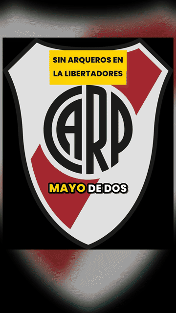
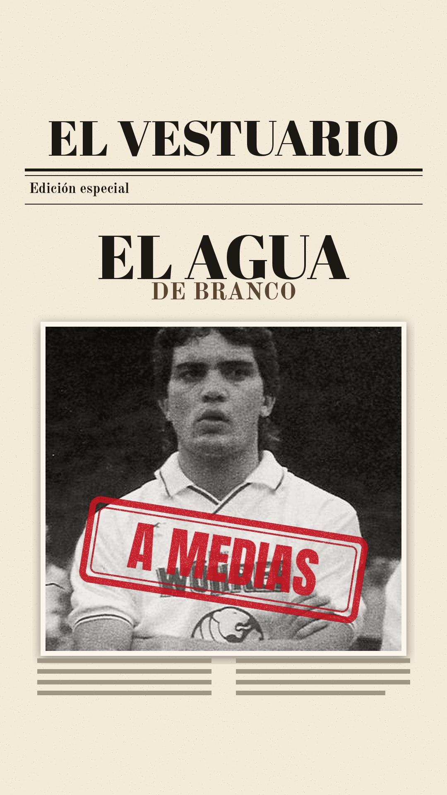

# Muestra · ¿Pasó de verdad?

**Idea elegida:** Maradona exigió una Ferrari F40 negra cuando solo existían rojas y Coppola tuvo que negociarla con el propio Enzo Ferrari. (puntaje 9)

**Veredicto:** VERDAD

**Título:** ¿Maradona pidió una Ferrari negra? (34 de 40 caracteres)

**Duración del video completo:** 36 segundos · 88 palabras · 6 escenas

**Esta muestra:** primeros 36 segundos · voz: gemini · Puck · tiempos whisper · imágenes: foto de Commons (3), Cloudflare (4)

 

[▶️ Ver los segundos de video con sonido](video.mp4)

## Guion completo

1. Diego Maradona quería una Ferrari F cuarenta, pero con un capricho imposible: no la quería roja, la quería negra.
2. En esa época la fábrica italiana no te cambiaba el color por nada del mundo: salían todas rojas.
3. Guillermo Coppola contó que tuvo que sentarse a pedirle la excepción directamente al mismísimo Enzo Ferrari.
4. Y lo logró. La marca rompió su propia tradición y pintó el auto de negro para el Diez.
5. Veredicto: verdad. Una anécdota delirante que el propio Coppola se encargó de confirmar.
6. ¿Lo sabías? Te leo.

## Texto para publicar

Coppola cuenta que Diego le pidió una Ferrari F40 con una condición insólita para la época: que no fuera roja. Mirá cómo terminó la historia.

#futbol #futbolargentino #maradona #coppola #historiasdelfutbol

## De dónde salen los datos

- [Guillermo Coppola](https://es.wikipedia.org/wiki/Guillermo_Coppola)
- [Diego Maradona](https://es.wikipedia.org/wiki/Diego_Maradona)
- El Marplatense: Las mejores anécdotas de Guillermo Coppola con Diego Maradona
- Serie 'Coppola, el representante' (Star+)
- [El Marplatense](https://www.elmarplatense.com/las-mejores-anecdotas-de-guillermo-coppola-con-diego-maradona)
- [El Marplatense](https://www.elmarplatense.com/las-mejores-anecdotas-de-guillermo-coppola-con-diego-maradona)
- [Río Negro](https://www.rionegro.com.ar/erre-n/mira-el-primer-adelanto-de-la-serie-sobre-guillermo-coppola-en-la-que-apareceran-retratados-scioli-y-cuneo-libarona-3394691/?amp=1)

## Fotos

- autor desconocido (Public domain), Wikimedia Commons
